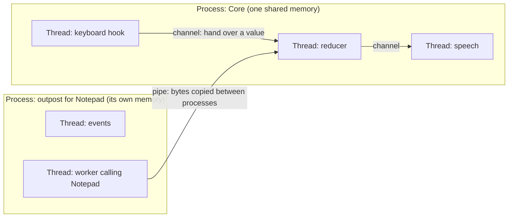

# Concurrency foundations: processes, threads and waiting

A self-contained guide for building the mental model behind Verbatim's architecture decisions: what processes and threads are, when to use each, how they coordinate, and how they wait. It ends with a reading list and eight runnable Rust exercises. Every example is tied back to Verbatim so the ideas land on code you already know.

Suggested order: read parts 1 to 6, do exercises 1 to 6, read the first group of the reading list, then do exercises 7 and 8 and the rest of the reading.

## Contents

1. The core model: processes and threads
2. What each one gives you
3. When to use a process, and when a thread
4. Coordination: the hard part is the same either way
5. Waiting: blocking, message loops and async
6. Windows specifics: message loops, COM apartments and UIA
7. Lessons from NVDA
8. Glossary
9. Reading list
10. Exercises
11. Self-check questions

## 1. The core model: processes and threads

A **program** is a file on disk. A **process** is a running program, and Windows gives each process its own walls:

- its own memory (its address space), which no other process can see or change;
- its own handles: open files, pipes, windows, events;
- its own security identity (its token), which decides what it may do.

A **thread** is one line of work inside a process. Each thread has its own stack (its local variables and the chain of function calls it is in) and its own position in the code. All the threads of a process share that process's memory and handles.

Windows schedules threads, not processes. A process with one thread can do one thing at a time; a process with five threads can be doing, or waiting on, five things at once. On a machine with several processor cores, several threads truly run at the same moment; on one core, Windows switches between them so quickly they appear to.

An analogy: **a process is a house, and threads are the people living in it.**

- People in one house share the kitchen (memory). Passing something is instant: you hand it over. But they can get in each other's way, and a fire burns the whole house.
- People in different houses cannot reach into each other's kitchens. They communicate by post (pipes), which is slower, and everything has to be packed into an envelope (turned into bytes, called serialization). A fire in one house leaves the others standing.

Verbatim today, as a picture:



## 2. What each one gives you

| Question                                                                                          | Threads in one process                                                                   | Separate processes                                                                      |
| ------------------------------------------------------------------------------------------------- | ---------------------------------------------------------------------------------------- | --------------------------------------------------------------------------------------- |
| Talking to each other                                                                             | Hand over a value or object through a channel; nanoseconds                               | Copy bytes through a pipe; microseconds, plus packing and unpacking                     |
| Sharing objects such as UIA elements                                                              | Yes                                                                                      | No. Only ids, because the object lives in the other process's memory                    |
| One crashes (access violation)                                                                    | The whole process dies                                                                   | Only that process dies                                                                  |
| One hangs forever                                                                                 | Only that thread stops, but anything waiting on it stops too                             | The same, but the process can be killed                                                 |
| Killing it cleanly                                                                                | Not possible. Killing a thread from outside can leave locks held and memory half-changed | Yes. Windows reclaims all its memory and handles                                        |
| Restricting what it may do (a sandbox)                                                            | Not possible. Every thread has the process's permissions                                 | Yes. A process can be given a weaker security identity                                  |
| Behaviour Windows applies per process, such as UIA's one event thread or UIA's connection timeout | Shared by every thread                                                                   | Each process gets its own                                                               |
| Cost                                                                                              | A stack, typically 1 MB reserved and much less used                                      | A full process: its own copies of libraries' data, COM and UIA setup, several megabytes |

Two rows matter most: **killing it cleanly** and **sandboxing**. Only a process can do them. Almost everything else is easier, faster and cheaper with threads.

Two details people often get wrong:

- **A Rust panic is not a crash.** A panic unwinds only the thread it happens on, and the process carries on (unless the program is built with `panic = "abort"`; Verbatim uses the default, unwinding). A crash, such as native code in a DLL writing through a bad pointer, ends the whole process, and Rust cannot catch it. Exercise 3 shows both.
- **A hung thread does not freeze the process,** only itself. The process freezes in practice when other threads wait on the hung one, for example by waiting for its answer with no deadline, or by needing a lock it holds.

## 3. When to use a process, and when a thread

**Default to threads.** Use one whenever something must keep happening while something else waits. A thread that makes a blocking call (a UIA call, reading a pipe, waiting for audio) simply sleeps until the answer comes, and the other threads carry on. That is why Verbatim's keyboard hook, reducer and speech each have their own thread: none can be held up by another's wait.

**Use a separate process only for a reason a thread cannot meet.** There are four:

1. **Untrusted code.** It needs a sandbox, and only a process can be sandboxed.
2. **Code that crashes.** You need to survive its crash.
3. **Code that hangs or leaks in a way only killing can undo.** You need to throw it away completely and get everything back.
4. **Behaviour Windows applies to a whole process.** You need a separate copy of it.

Applied to Verbatim:

| Process                     | Reason                                                                                                                                                                                                                              |
| --------------------------- | ----------------------------------------------------------------------------------------------------------------------------------------------------------------------------------------------------------------------------------- |
| Synthesizer host            | 1 and 2: third-party engines that crash on particular text                                                                                                                                                                          |
| Extension hosts             | 1: third-party code                                                                                                                                                                                                                 |
| Focus listener              | 4: UIA delivers all of a process's events on one internal thread, and its focus tracking can hold that thread for seconds on a hung window                                                                                          |
| One outpost per application | 3, and partly 4: a stuck UIA call can only be undone by killing the process, and each process gets its own UIA event queue. This is the one under debate, because a stuck thread can also be abandoned and left behind (exercise 6) |

A useful habit: whenever someone proposes a process boundary, ask which of the four reasons it serves, and whether that reason is measured or assumed.

## 4. Coordination: the hard part is the same either way

Most concurrency bugs are not caused by choosing processes or threads. They come from **two workers making decisions about the same fact** without one clear owner, or from making assumptions about the order things happen in. That happens between threads as easily as between processes. Verbatim's costliest bugs were of this kind.

There are three ways for workers to coordinate:

- **Share memory and take turns.** A lock (a `Mutex` in Rust) lets one thread at a time change a value. Simple, but easy to get wrong: forgetting the lock, holding it too long, or two threads each waiting for a lock the other holds (a deadlock).
- **Send messages.** Each worker keeps its own data and tells the others what happened, through channels (inside a process) or pipes (between processes). The Go language's motto sums it up: "Do not communicate by sharing memory; instead, share memory by communicating."
- **One owner per fact.** Only one worker may change a given thing; others ask it or are told. This is what Verbatim's ownership rules (`books/dev/src/explanation/design/ownership.md`) enforce.

Processes force message passing, because they cannot share memory. Threads allow all three styles. Rust prevents threads from touching shared memory without a lock (a "data race"), and exercise 5 shows the compiler refusing. But Rust cannot stop two owners from deciding the same thing differently, nor stop messages arriving in an order you did not expect. Those are design problems, and they need design rules.

Three classic traps to recognise:

- **Race condition:** the outcome depends on which of two things happens first. Example: a focus read that finishes after a later focus was already applied.
- **Lost wake-up:** a thread decides to sleep because it believes there is no work, just as work arrives, and nothing wakes it.
- **Deadlock:** two threads each wait for something the other holds, forever.

## 5. Waiting: blocking, message loops and async

Much of a screen reader's time is spent waiting: for keys, for events, for applications to answer. There are three ways to organise waiting.

**Blocking calls on dedicated threads.** A thread calls something and sleeps until the answer arrives. Windows wakes it. This is the simplest model, and it is Verbatim's. The cost is one thread per thing that can be waited on at once.

**Waiting on several things at once.** A thread can wait for whichever of several things happens first: `WaitForMultipleObjects` for Windows events, an I/O completion port for many pipes, or `select!` over several channels in Rust (exercise 7). The thread wakes once, finds out which was ready, and handles it.

**A message loop** is a thread whose whole job is waiting on a queue of messages and handling each one in turn: `GetMessage`, then `DispatchMessage`, forever. Every window belongs to the thread that created it, and that thread must run a message loop or the window stops responding. A "hung application" is usually exactly this: its window's thread is stuck doing something else and has stopped taking messages, so anything sent to it waits.

**Async** (in Rust: `async fn`, `.await`, and a runtime such as Tokio) is a different way to write waiting. You write code that looks sequential, such as "ask the outpost, give up after two seconds, and meanwhile also listen for a cancel", and the compiler turns it into a state machine. A runtime then runs many such tasks on a few threads, switching between them whenever one is waiting. Exercise 8 is exercise 7 rewritten this way, plus a deadline in one line.

What async is good at: expressing "wait for any of these, with a deadline, and cancel the rest" concisely. This is what is meant by expressiveness. What it cannot do: make a blocking call stop blocking. A UIA call still blocks whatever thread makes it, so such calls still need their own threads, and an async program hands them to those threads and awaits the answer. Its usual traps are a task that blocks without meaning to (freezing every other task on that thread), and work silently dropped when `select!` abandons a branch halfway ("cancellation safety").

The two styles are not opposites. Verbatim's reducer is a hand-written, explicit state machine, chosen so it can be replayed and tested exactly; async hides the state machine inside the compiler. Async could suit the glue code that coordinates threads and pipes, but not the reducer.

## 6. Windows specifics: message loops, COM apartments and UIA

These are the ideas that turn "a blocked call stops one thread" into the specific behaviours Verbatim fights.

- **A cross-thread `SendMessage` waits** until the receiving thread takes the message from its queue. If that thread is hung, the sender waits too, unless it used `SendMessageTimeout`.
- **COM apartments.** COM, the system UIA and MSAA are built on, groups threads into apartments. A single-threaded apartment (STA) belongs to one thread with a message loop, and calls into its objects arrive through that thread's message queue. A multithreaded apartment (MTA) lets any of its threads call its objects directly. Verbatim's workers are in the MTA. Calls into another process's STA wait on that application's message loop, which is how a hung application holds a caller.
- **COM objects belong to a process.** An interface pointer is meaningful only in the process that holds it. To use it from another process, COM would have to create a proxy, and UIA elements cannot be passed that way at all. Hence Verbatim's node ids.
- **UIA's client library** is loaded into the screen reader's process. Its calls wait on a channel of its own, not a COM call, so `CoCancelCall` cannot cancel them (Verbatim measured this). It delivers all of a process's events on one internal thread, and for classic Win32 windows it builds some events itself by calling into the application. That is why one slow application can hold every UIA event in the process.
- **Job objects** group processes so they can be limited and killed together. Verbatim puts every child in a job that kills it when Core's handle closes, so a crashed Core leaves no orphans.

The repository's explainers cover each of these in more depth (see the reading list). They were written by Claude, so read them alongside an independent source.

## 7. Lessons from NVDA

NVDA's issue record shows what goes wrong when many applications' events share one thread that calls into applications:

- **One thread serving every application.** NVDA's main thread handles events from all applications and makes live calls into the one that raised each event, so a slow background application stalls speech and keys ([nvaccess/nvda#3831](https://github.com/nvaccess/nvda/issues/3831), [nvaccess/nvda#16749](https://github.com/nvaccess/nvda/issues/16749)).
- **Calling into an application to decide whether to ignore it.** NVDA's UIA handlers work out an event's window, which can call into the application, before the filter that drops background events ([nvaccess/nvda#18239](https://github.com/nvaccess/nvda/issues/18239)).
- **UIA's shared per-process queue.** A busy application stopped all of NVDA's UIA events, while non-UIA reading kept working ([nvaccess/nvda#7345](https://github.com/nvaccess/nvda/issues/7345)).
- **Input sharing a queue with output.** Keys wait behind thousands of terminal lines ([nvaccess/nvda#20902](https://github.com/nvaccess/nvda/issues/20902)).

The rules these suggest hold whether Verbatim's readers are processes or threads:

1. No thread that calls into applications serves events from more than one application.
2. Decide whether to drop an event from facts that cost no call into the application.
3. Register only for the events you use.
4. Bound every queue an application can fill, and keep input and speech off it.
5. Stop calling into a window once Windows reports it hung.

## 8. Glossary

- **Address space:** the memory a process can see. Each process has its own.
- **Blocking call:** a call that does not return until its answer arrives; the calling thread sleeps meanwhile.
- **Channel:** a queue for passing values between threads inside one process.
- **Pipe:** a channel for bytes between processes, provided by Windows.
- **Serialization:** turning a value into bytes so it can cross a pipe, and back again on the other side.
- **Handle:** a number a process uses to refer to something Windows manages: a file, pipe, event, thread or process.
- **Lock (mutex):** lets one thread at a time use a piece of shared data.
- **Atomic:** a small value, such as a counter or flag, that threads can change safely without a lock.
- **Data race:** two threads using the same memory at once, at least one writing, without coordination. Rust's compiler prevents these.
- **Race condition:** the result depends on the order in which things happen.
- **Deadlock:** threads waiting on each other forever.
- **Message loop:** a thread repeatedly taking messages from its queue and handling them; every window needs one.
- **Apartment (COM):** the threading rules a COM object lives under; STA (one thread, message loop) or MTA (many threads).
- **Abandoning a thread:** giving up waiting for it while it stays stuck; it is freed only when its call returns or the process ends.
- **Sandbox:** a process run with reduced rights, so code inside it cannot reach files, the network or other processes.
- **Job object:** a Windows group of processes that can be limited and killed together.
- **Async / future / runtime:** a way to write waiting code as sequential steps; the compiler makes a state machine (a future) and a runtime runs many of them on few threads.

## 9. Reading list

### First: the foundations

1. **_Operating Systems: Three Easy Pieces_** (OSTEP), by Remzi and Andrea Arpaci-Dusseau. Free, written for beginners, and the best foundation. Each chapter is a separate PDF with real text. The examples use Linux and C, but the ideas carry over to Windows unchanged.
   - [The Abstraction: The Process](https://pages.cs.wisc.edu/~remzi/OSTEP/cpu-intro.pdf)
   - [Interlude: Process API](https://pages.cs.wisc.edu/~remzi/OSTEP/cpu-api.pdf)
   - [Concurrency: An Introduction](https://pages.cs.wisc.edu/~remzi/OSTEP/threads-intro.pdf)
   - [Interlude: Thread API](https://pages.cs.wisc.edu/~remzi/OSTEP/threads-api.pdf)
   - [Locks](https://pages.cs.wisc.edu/~remzi/OSTEP/threads-locks.pdf)
   - [Condition Variables](https://pages.cs.wisc.edu/~remzi/OSTEP/threads-cv.pdf)
   - [Common Concurrency Problems](https://pages.cs.wisc.edu/~remzi/OSTEP/threads-bugs.pdf)
   - [Event-based Concurrency](https://pages.cs.wisc.edu/~remzi/OSTEP/threads-events.pdf), the idea behind message loops and async
   - The [book's home page](https://pages.cs.wisc.edu/~remzi/OSTEP/) lists every chapter.
2. **The Rust Book, chapter 16, [Fearless Concurrency](https://doc.rust-lang.org/book/ch16-00-concurrency.html):** threads, channels and locks in Rust, with how the compiler prevents data races.
3. **_Rust Atomics and Locks_**, by Mara Bos, free online. Read [chapter 1, Basics of Rust Concurrency](https://marabos.nl/atomics/basics.html) now; the [rest of the book](https://marabos.nl/atomics/) later if you want to understand what crossbeam and arc-swap do inside.

### Second: Windows

4. **Microsoft Learn, [About Processes and Threads](https://learn.microsoft.com/en-us/windows/win32/procthread/about-processes-and-threads)**, and **[Job Objects](https://learn.microsoft.com/en-us/windows/win32/procthread/job-objects)**.
5. **Microsoft Learn, [Window Messages](https://learn.microsoft.com/en-us/windows/win32/learnwin32/window-messages)**: the message loop, from the "Learn to Program for Windows" series.
6. **Microsoft Learn, [Processes, Threads, and Apartments](https://learn.microsoft.com/en-us/windows/win32/com/processes--threads--and-apartments)**: COM's threading rules.
7. **Microsoft Learn, [Understanding Threading Issues](https://learn.microsoft.com/en-us/windows/win32/winauto/uiauto-threading)**: UIA's threading rules for clients.
8. **Raymond Chen's blog, [The Old New Thing](https://devblogs.microsoft.com/oldnewthing/):** decades of short posts on why Windows behaves as it does. Search it for "SendMessage", "message loop", "apartment" or "hung".

### Third: Verbatim's own explainers

Written by Claude for this project, so they share its framing; read them after an independent source on the same topic.

9. [`books/dev/src/explanation/windows/processes-and-security.md`](../books/dev/src/explanation/windows/processes-and-security.md)
10. [`books/dev/src/explanation/windows/windows-and-messages.md`](../books/dev/src/explanation/windows/windows-and-messages.md)
11. [`books/dev/src/explanation/windows/com.md`](../books/dev/src/explanation/windows/com.md)
12. [`books/dev/src/explanation/windows/ipc.md`](../books/dev/src/explanation/windows/ipc.md)
13. [`books/dev/src/explanation/windows/rust-concurrency.md`](../books/dev/src/explanation/windows/rust-concurrency.md)
14. [`docs/nvda/main-loop-and-watchdog.md`](../docs/nvda/main-loop-and-watchdog.md): how NVDA's single main thread and watchdog work.

### Fourth: the crates and async

15. **crossbeam-channel** [documentation](https://docs.rs/crossbeam-channel): channels and `select!`.
16. **arc-swap** [documentation](https://docs.rs/arc-swap): sharing a value many threads read and one occasionally replaces.
17. **The [Tokio tutorial](https://tokio.rs/tokio/tutorial)**: async Rust in practice.
18. **Alice Ryhl, [Actors with Tokio](https://ryhl.io/blog/actors-with-tokio/)**: the actor pattern, which maps closely onto outposts. The clearest way to judge the expressiveness argument for yourself.

## 10. Exercises

Each is a short Rust program. Do them on your Windows machine, run each, and read its output before moving on. All eight were compiled and run before this guide was written.

### Setup

Create a project and add two dependencies, used only by exercises 7 and 8:

```bash
cargo new concurrency-exercises
```

Then add these lines under `[dependencies]` in its `Cargo.toml`:

```toml
crossbeam-channel = "0.5"
tokio = { version = "1", features = ["rt", "macros", "time", "sync"] }
```

Put each exercise in its own file under `src/bin/`, named as in its heading, and run it by name:

```bash
cargo run --bin ex1_channel
```

### Exercise 1: two threads and a channel (`src/bin/ex1_channel.rs`)

What it shows: one thread sends values, another receives them; the receiver sleeps until each arrives; the channel closes when the sender is dropped.

```rust
use std::sync::mpsc;
use std::thread;
use std::time::Duration;

fn main() {
    // A channel has two ends: a sender and a receiver.
    let (sender, receiver) = mpsc::channel();

    // Start a second thread. `move` gives the sender to that thread.
    let worker = thread::spawn(move || {
        for number in 1..=5 {
            println!("worker: sending {number}");
            sender.send(number).unwrap();
            thread::sleep(Duration::from_millis(200));
        }
        // When the worker ends, its sender is dropped and the channel closes.
    });

    // The main thread waits for each value. `recv` sleeps until one arrives,
    // and returns an error once the channel is closed and empty.
    while let Ok(number) = receiver.recv() {
        println!("main: received {number}");
    }

    worker.join().unwrap();
    println!("main: the worker has finished");
}
```

Try: remove the `sleep` in the worker and run it several times. Does the order of the "sending" and "received" lines change between runs? That variation is concurrency.

### Exercise 2: a blocked thread does not stop the others (`src/bin/ex2_blocked_thread.rs`)

What it shows: a thread stuck in a long call stops only itself, and ending the process ends the stuck thread too.

```rust
use std::thread;
use std::time::Duration;

fn main() {
    // This thread blocks for a long time, standing in for a call into
    // an application that has stopped responding.
    thread::spawn(|| {
        println!("stuck thread: starting a call that will not return for an hour");
        thread::sleep(Duration::from_secs(3600));
        println!("stuck thread: this is never printed");
    });

    // The main thread is not affected: it keeps working.
    for tick in 1..=5 {
        println!("main: still working, tick {tick}");
        thread::sleep(Duration::from_millis(500));
    }

    // Returning from main ends the whole process, including the stuck thread.
    // Windows reclaims everything the process held.
    println!("main: exiting; the process ends and takes the stuck thread with it");
}
```

Try: make the main thread wait for the stuck thread with `.join()`. Now the main thread is stuck too. That is how one hung call spreads: not by itself, but through whoever waits on it.

### Exercise 3: a panic and a crash (`src/bin/ex3_crash.rs`)

What it shows: a Rust panic ends only its own thread; a real crash (an access violation, as native code in a DLL might cause) ends every thread in the process.

```rust
use std::thread;
use std::time::Duration;

fn main() {
    let mode = std::env::args().nth(1).unwrap_or_default();

    // A speech-like thread that should keep talking.
    thread::spawn(|| {
        for n in 1.. {
            println!("speech thread: still speaking ({n})");
            thread::sleep(Duration::from_millis(300));
        }
    });

    thread::sleep(Duration::from_millis(1000));

    if mode == "panic" {
        // A Rust panic unwinds only the thread it happens on.
        let result = thread::spawn(|| panic!("reader thread: a Rust panic")).join();
        println!("main: the reader thread panicked: {}", result.is_err());
        println!("main: the process is still alive; watch the speech thread continue");
        thread::sleep(Duration::from_millis(1500));
    } else {
        // A real crash: writing through a null pointer. This is what a bug in
        // native code such as a DLL does. Rust cannot catch it, and Windows ends
        // the whole process, every thread with it.
        // (This is deliberately undefined behaviour, used only to show a crash.)
        thread::spawn(|| unsafe {
            println!("reader thread: crashing now");
            std::ptr::null_mut::<i32>().write_volatile(1);
        });
        thread::sleep(Duration::from_millis(1500));
        println!("main: this line is never printed");
    }
}
```

Run it twice: `cargo run --bin ex3_crash -- panic`, then `cargo run --bin ex3_crash -- crash`. In the second run the speech thread stops mid-sentence, and the exit code is `0xC0000005`, Windows' access violation. This is the risk of loading UIA's client library into the same process as speech.

### Exercise 4: a child process, a pipe and a kill (`src/bin/ex4_child_process.rs`)

What it shows: two processes talk only through bytes in a pipe; a hung child can be killed, and Windows reclaims everything it held.

```rust
use std::io::{BufRead, BufReader, Write};
use std::process::{Command, Stdio};
use std::time::Duration;

fn main() {
    // Run as the child when given "child".
    if std::env::args().nth(1).as_deref() == Some("child") {
        return child();
    }

    // Start a second copy of this program as a child process, with pipes
    // connected to its standard input and output.
    let mut child = Command::new(std::env::current_exe().unwrap())
        .arg("child")
        .stdin(Stdio::piped())
        .stdout(Stdio::piped())
        .spawn()
        .unwrap();

    let mut to_child = child.stdin.take().unwrap();
    let mut from_child = BufReader::new(child.stdout.take().unwrap());

    // Everything crossing the pipe is bytes: here, lines of text.
    for word in ["hello", "screen", "reader"] {
        writeln!(to_child, "{word}").unwrap();
        let mut reply = String::new();
        from_child.read_line(&mut reply).unwrap();
        println!("parent: sent {word:?}, child replied {:?}", reply.trim());
    }

    // Ask for something that makes the child hang, then kill it.
    writeln!(to_child, "hang").unwrap();
    std::thread::sleep(Duration::from_millis(500));
    println!("parent: the child is hung; killing it");
    child.kill().unwrap();
    let status = child.wait().unwrap();
    println!("parent: child ended with {status}; its memory and handles are reclaimed");
}

fn child() {
    let stdin = std::io::stdin();
    for line in stdin.lock().lines() {
        let line = line.unwrap();
        if line == "hang" {
            // Stand-in for a call that never returns.
            std::thread::sleep(Duration::from_secs(3600));
        }
        println!("{}", line.to_uppercase());
    }
}
```

Think about: what would it take to send a Rust `struct` instead of a line of text? (Answer: serializing it to bytes and back, which is what Verbatim's frames do.) And why can't the parent send the child a reference to one of its own values?

### Exercise 5: shared data and the compiler (`src/bin/ex5_shared_counter.rs`)

What it shows: four threads change one counter safely by taking turns with a lock; Rust refuses the unsafe version at compile time.

```rust
use std::sync::{Arc, Mutex};
use std::thread;

fn main() {
    // Arc lets several threads own the same value; Mutex lets only one
    // thread at a time change it.
    let counter = Arc::new(Mutex::new(0));
    let mut handles = Vec::new();

    for _ in 0..4 {
        let counter = Arc::clone(&counter);
        handles.push(thread::spawn(move || {
            for _ in 0..100_000 {
                *counter.lock().unwrap() += 1;
            }
        }));
    }
    for handle in handles {
        handle.join().unwrap();
    }
    println!("total: {} (always 400000)", *counter.lock().unwrap());

    // Try this instead, and read the compiler's error:
    //
    // let mut plain = 0;
    // let a = thread::spawn(|| { plain += 1; });
    // let b = thread::spawn(|| { plain += 1; });
    //
    // Rust refuses: two threads could change `plain` at once.
}
```

Try: uncomment the last block and read the error. Then rewrite the program so that no lock is needed: each thread counts its own total and sends it to the main thread over a channel, which adds them up. That is "one owner per fact" in miniature.

### Exercise 6: a deadline and an abandoned thread (`src/bin/ex6_abandon.rs`)

What it shows: how a screen reader bounds a call it cannot cancel. The call runs on a thread of its own; the caller waits only until its deadline, then gives up and abandons the thread. This is NVDA's `cancellableExecute` and the abandonment of Verbatim's outpost worker (`crates/verbatim-outpost/src/outpost/shell.rs`) in miniature.

```rust
use std::sync::mpsc;
use std::thread;
use std::time::Duration;

/// Runs `call` on a thread of its own and waits at most `deadline` for it.
/// If the call takes longer, the thread is abandoned: we stop waiting for it,
/// but it cannot be stopped and keeps running until the call returns or the
/// process ends.
fn call_with_deadline<T: Send + 'static>(
    deadline: Duration,
    call: impl FnOnce() -> T + Send + 'static,
) -> Option<T> {
    let (sender, receiver) = mpsc::channel();
    thread::spawn(move || {
        let result = call();
        // If we were abandoned, nobody is listening, and this send fails quietly.
        let _ = sender.send(result);
    });
    receiver.recv_timeout(deadline).ok()
}

fn main() {
    let fast = call_with_deadline(Duration::from_secs(1), || {
        thread::sleep(Duration::from_millis(100));
        "the name of a button"
    });
    println!("fast call: {fast:?}");

    let slow = call_with_deadline(Duration::from_secs(1), || {
        // An application that has stopped responding.
        thread::sleep(Duration::from_secs(3600));
        "never returned"
    });
    println!("slow call: {slow:?} (abandoned after one second)");

    println!("main: carrying on; the abandoned thread still exists until the process ends");
}
```

Think about: each abandoned thread keeps its stack and anything it holds until its call returns. How many could pile up before it mattered? This is the heart of the outpost question: abandoning threads and occasionally restarting, against a process per application that can be killed.

### Exercise 7: waiting on several things at once (`src/bin/ex7_select.rs`)

What it shows: one thread waiting on keys, events and a timeout together, and waking for whichever comes first.

```rust
use crossbeam_channel::{after, select, unbounded};
use std::thread;
use std::time::Duration;

fn main() {
    let (keys_tx, keys) = unbounded::<&str>();
    let (events_tx, events) = unbounded::<&str>();

    thread::spawn(move || {
        for key in ["down arrow", "down arrow", "enter"] {
            thread::sleep(Duration::from_millis(400));
            keys_tx.send(key).unwrap();
        }
    });
    thread::spawn(move || {
        for event in ["focus: OK button", "name changed"] {
            thread::sleep(Duration::from_millis(700));
            events_tx.send(event).unwrap();
        }
    });

    // One thread waits on two channels and a timeout at once, and wakes for
    // whichever is ready first.
    loop {
        select! {
            recv(keys) -> key => match key {
                Ok(key) => println!("key: {key}"),
                Err(_) => break,
            },
            recv(events) -> event => match event {
                Ok(event) => println!("event: {event}"),
                Err(_) => break,
            },
            recv(after(Duration::from_secs(2))) -> _ => {
                println!("nothing for two seconds; stopping");
                break;
            }
        }
    }
}
```

Think about: this loop is a small reducer's shell. Keys and events arrive from different threads, and the loop handles them one at a time in the order they arrive, so the code that handles them never runs on two threads at once.

### Exercise 8: the same waiting in async (`src/bin/ex8_async.rs`)

What it shows: exercise 7 written with Tokio, on a single thread, plus "ask, but give up after a deadline" in one line. Compare the two and judge the expressiveness argument for yourself.

```rust
use std::time::Duration;
use tokio::sync::mpsc;
use tokio::time::{sleep, timeout};

// A single-threaded Tokio runtime: everything below runs on one OS thread.
#[tokio::main(flavor = "current_thread")]
async fn main() {
    let (keys_tx, mut keys) = mpsc::unbounded_channel::<&str>();
    let (events_tx, mut events) = mpsc::unbounded_channel::<&str>();

    tokio::spawn(async move {
        for key in ["down arrow", "down arrow", "enter"] {
            sleep(Duration::from_millis(400)).await;
            keys_tx.send(key).unwrap();
        }
    });
    tokio::spawn(async move {
        for event in ["focus: OK button", "name changed"] {
            sleep(Duration::from_millis(700)).await;
            events_tx.send(event).unwrap();
        }
    });

    // The same waiting as exercise 7, written as async code.
    loop {
        tokio::select! {
            Some(key) = keys.recv() => println!("key: {key}"),
            Some(event) = events.recv() => println!("event: {event}"),
            () = sleep(Duration::from_secs(2)) => {
                println!("nothing for two seconds; stopping");
                break;
            }
        }
    }

    // "Ask, but give up after a deadline" in one line.
    let answer = timeout(Duration::from_millis(300), async {
        sleep(Duration::from_secs(5)).await; // a slow answer
        "late"
    })
    .await;
    println!("asked with a deadline: {answer:?}");
}
```

Try: inside one of the spawned tasks, replace `sleep(...).await` with `std::thread::sleep(Duration::from_secs(3))`, a blocking call. Run it and notice that everything else stops too, because all tasks share one thread. That is why async cannot help with blocking UIA calls by itself: they would still need threads of their own.

## 11. Self-check questions

Answer these in your own words. When you can, you have the foundation needed to judge Verbatim's process layout yourself.

1. Why can't a UIA element found in an outpost be handed to Core, when a value can be handed between two threads of Core?
2. A thread is stuck in a UIA call. What are your two options for getting on with work, and what does each cost?
3. Why does a crash in UIA's client library inside Core silence speech, while a crash in an outpost does not?
4. Which of the four reasons for a process does each Verbatim process serve, and which of those reasons are measured rather than assumed?
5. Moving every reader into one process removes some bugs and adds some risks. Name two of each.
6. Why does putting the focus listener on a thread instead of in its own process not avoid the hung-window hold?
7. What is NVDA's central threading mistake, and does it depend on whether NVDA uses processes or threads?
8. What would async make easier in Verbatim, and what would it not change at all?
