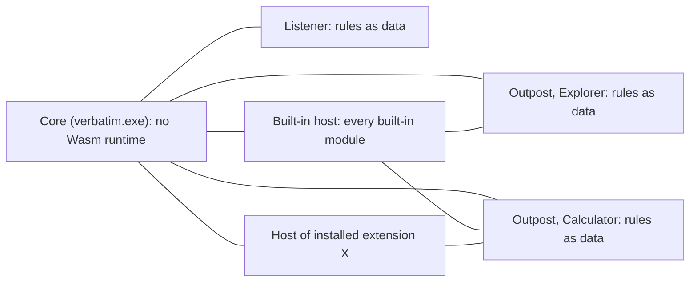

# M5 extensions: scoping study

A scoping study for Dickson, 2026-11-09, covering four questions: built-ins as one extension, the process each planned extension feature runs in, per-user configuration, and opening `.vext` files. Nothing is committed. Sources: `docs/roadmap.md` (M5, M6, M8.x, M10, M13, M18), `docs/design/extensions.md`, `docs/design/m5-extensions-work.md`, `docs/design/security-model.md`, the architecture's D6 and D18, and NVDA at the pinned commit `732d1ce2f0f051da3ef1e6a6247c64cf04596337`.

Terms used here: the **built-in host** is the one extension host process that, under proposal 1, runs every built-in module. A **gated action** is any extension request that Core must judge against attention before it happens (cancelling speech, acting on a node, a timer firing).

## Decisions for Dickson, in one batch

Every item below is in an area Dickson owns: process layout, trust boundaries, what users hear, or public contracts.

| # | Decision | Recommendation |
|---|---|---|
| 1 | Run all built-ins (app modules and global modules) as one internal extension in a host process of their own, with no Wasm runtime in Core or any outpost. This amends D6 and X4, X5 and A9 of the security model. | Yes. |
| 2 | The breaker (A9) counts failures per built-in module, not for the built-in extension as a whole. | Yes. Otherwise three Calculator traps in a minute would turn off Explorer and Terminal too. |
| 3 | A host reads an application through a pipe straight to the claiming outpost. Every effect and every gated action goes through Core. | Yes (section 2.2). |
| 4 | Global modules in M5 need three things the M5 surface lacks: a list prompt shown by Core with its answer, a click at a location, and a clock. Options: pull these three into M5's surface, or keep the tray list, taskbar list and time in core code until M13. | Pull in the three, kept narrow (section 2.3). |
| 5 | Where per-user files live for an installed copy: Roaming or Local application data. | Deferred to M8.7 with the installed copy (Dickson, 2026-11-09). Recommendation kept for then: settings and extensions in Roaming, compiled code, logs and dumps in Local (section 3.3). |
| 6 | How a portable copy gets `.vext` files opened by its helper. | Settled (Dickson, 2026-11-09): the Extensions dialog always has an Install from file button, as NVDA has; a portable copy registers no file association. |
| 7 | What happens to a `.vext` file opened while Verbatim is not running. | Settled (Dickson, 2026-11-09): as NVDA does, the helper shows a message box that Verbatim must be running. |

## 1. Built-ins as one extension

### 1.1 What the proposal changes

The current design (D6, amended 2026-11-06; `extensions.md` section 6) runs built-in app modules on the outpost's worker and built-in global modules on Core threads. Each installed extension runs in a host process of its own. So wasmtime would be linked into three programs: `verbatim.exe`, `verbatim-outpost.exe` and the extension host.

The proposal treats every built-in as a module of one internal extension. That extension is loaded like any installed one but is never listed, never disabled, and keeps its strings in Verbatim's Fluent resources. It runs in one host process.

### 1.2 What it removes

- **wasmtime from Core and the outposts.** Only the host program links it. `verbatim-ext` becomes a dependency of the host alone, so an outpost's memory and start-up time no longer depend on whether its application has a module.
- **The epoch problem of the work plan's step 0b,** where an abandoned outpost worker still inside a hook would advance the shared engine's epoch and interrupt its replacement. Outpost workers never run guest code, so that case no longer exists. A similar problem does appear in the host (section 1.4).
- **Two code paths for hooks.** A built-in hook and an installed hook become the same thing: a round trip from the outpost's worker to a host. The hook chain across layers (`extensions.md` section 7) then has one shape.
- **X5's special case for built-ins.** Compiled code is mapped only by the host that runs it, so built-in compiled code no longer has to live where outposts may map it.
- **A privilege gap.** Today a Wasm escape in a built-in reaches an outpost, which cannot run in an AppContainer (`extensions.md` section 13.3) and holds the user's full rights. Under the proposal it reaches only a contained host.
- **One reload path.** Hot reload of a built-in becomes the developer-folder path: the host validates, compiles and swaps the module, and the outposts swap rule tables in intake order.
- **M10's reason for deferral weakens.** Scripted modules were put off because "a script engine compiled to Wasm costs every outpost that hosts it". Under the proposal the engine's cost is paid once per host, not once per outpost.

### 1.3 What it costs

- **A hop on every hook.** `extensions.md` section 8.2 priced an installed extension's hook at one round trip and two wake-ups, plus two wake-ups per read. Built-ins now pay the same. A hop is tens of microseconds (`docs/design/communication.md`, decision 1's measurement), so D15's 10 ms budget is not at risk. Wake-ups do grow, on these paths:
  - Terminal's twin rule: every UIA focus event on `TermControl`, plus its `window()` reads.
  - Explorer's code hooks: the desktop-icon veto, the tab-switch announcement, and the name fixes.
  - Calculator: every display-updated notification.

  Rules-only modules (about 50 of NVDA's 78) cost nothing, because rules stay data in the outposts and the listener.
- **One process that is nearly always running.** The taskbar is Explorer, and global modules have no application, so the built-in host runs from start-up. Its memory counts against the budget. Under the current design every outpost with a module paid for a wasmtime engine instead, so the proposal is probably smaller overall. Step 0b measures both.
- **A shared blast radius.** A wasmtime crash or an out-of-memory in the built-in host ends every built-in at once, until the supervisor restarts the host. That host is first-party code with no native code, so a crash means a Verbatim defect. Recovery: restart with backoff, and every outpost's waiting hook answers `pass`.

### 1.4 New problems the design must answer

- **Threads inside the host.** No document says how a host's threads are laid out yet; step 0b leaves this to the host's design. The rule a design needs: a hook waiting on a read from one application must never hold up a hook for another application. A read from a hung application can block for up to 10 seconds. One thread per outpost the host serves is enough, because one outpost's hooks are called one at a time while its worker waits. Global modules need a thread of their own. This applies to any installed extension that claims several applications, so proposal 1 adds no new requirement. It does make the requirement certain to be met, because the built-in host serves every inbox application.
- **The epoch is per engine.** With many stores running at once in one engine, raising the epoch to stop one hook would interrupt the others. Step 0b's answer still applies: each store's deadline callback checks its own hook's time before it traps, so only the hook that overran stops.
- **Breaker granularity** (decision 2). The breaker should be keyed by module for built-ins and by extension for installed extensions. This needs a new spoken line, for example "Built-in module Calculator was turned off after repeated failures". Its wording is decision material.
- **Per-module resource figures** (A6). One process holds every built-in, so the job object's accounting cannot split figures by module. The host reports memory and guest time per store instead.
- **Layer order** still puts built-ins below installed extensions. The layer is set by the extension's kind, not by which process runs it.

### 1.5 Documents to amend if accepted

D6 and section 7 of the architecture; the process list in architecture section 1, item 1 (the global modules' threads go); `extensions.md` sections 1, 2.2, 2.3, 6 and 8.2 and 8.3; the security model's X4, X5 and A9; the work plan's step 0b (the global-module and epoch bullets) and step 4 (the bindings move from the outpost worker into the host, and outpost reads are served over a pipe); the roadmap's M5 entry, "one built-in module instance per outpost".

## 2. Every planned extension feature, by process

### 2.1 The table

Columns: where the module's code runs; where the host side of the feature runs; how it gets there; whether it can work, with any concern. Under proposal 1, "host" means the built-in host for built-ins and the extension's own host otherwise.

| Feature (milestone) | Module code | Feature runs in | Route | Viable? |
|---|---|---|---|---|
| Window rules: backend, silent, normalize-class (M5) | none | listener and outposts | Core publishes versioned tables | Yes; data only |
| Event rules: accept, drop (M5) | none | judged in Core; accept makes the supervisor start an outpost | tables | Yes |
| Node rules (M5) | none | outpost, where it emits a snapshot | tables | Yes |
| Focus veto rule (M5) | none | listener, from the event's cache | tables | Yes |
| Focus redirect rule (M5) | none | outpost (it needs reads) | tables | Yes |
| `on-event` hook with pass, drop, replace, rewrite, adopt (M5) | host | outpost worker waits; the verdict goes to the outpost's reducer | outpost to host and back; reads go host to outpost | Yes; the worker serves the host's reads while it waits |
| `on-node` hook (M5) | host | outpost | same | Yes; one round trip per matched snapshot, so the call ledger row is needed |
| `status-bar` (M5) | host | outpost | Core to outpost to host | Yes |
| `on-command` and `pass-through` (M5) | host | resolved in Core, run in key order through the outpost | Core to outpost to host | Yes; two round trips while the key is held |
| `on-load` and `on-unload` (M5) | host | the supervisor tells the host when an outpost starts and ends | Core to host | Yes |
| speak, cancel, tone, browseable message (M5) | host | Core judges attention; the GUI shows the message | host to Core | Yes; Core knows the instance's application from the pipe |
| Process facts, read-only settings view (M5) | host | Core sends them at instantiation and on each version change | Core to host | Yes |
| Log (M5) | host | Core's ring | host to Core | Yes |
| Capabilities derived from imports (M5) | none | Core, reading the component's imports with a parser, no runtime | none | Yes |
| Install, package reader, install dialog (M5) | none | Core (dialog-only mode too, section 4.2) | none | Yes |
| Hot reload and validation (M5) | host | Core watches and validates the manifest and rules; the host compiles and swaps | Core to host | Yes; compilation moves to the host |
| Breaker, resource figures (M5) | none | Core judges; the host reports per store | host to Core | Yes, if decision 2 is accepted |
| Binding by application identity (M5) | none | supervisor | none | Yes |
| Snapshot properties (M5 step 1) | none | outposts | none | Yes |
| Log viewer and Verbatim+F1 (M5) | none | Core GUI, with module instances reported by the hosts | none | Yes |
| Sleep-mode list (M5) | none | Core | none | Yes |
| `verbatim-inspect call` (M5) | host | developer endpoint in Core, relayed to the host's dynamic call path | Core to host | Yes |
| Global modules: tray list, taskbar list, time (M5) | built-in host | reads in Explorer's outpost; list dialog and click in Core | host to Core to outpost | **Not with the M5 surface** (section 2.3) |
| Terminal twin rule (M5 step 9) | built-in host | Terminal's outpost applies adopt or drop | outpost to host | Yes; one hop per `TermControl` focus event |
| Synthesizer modules, Wasm or native (M6) | extension's host | Core's mixer plays the PCM | host to Core over D18's protocol | Yes; the host program and the synthesizer host should be one program |
| Browse-mode default declaration (M7) | none | Core | none | Yes |
| IA2 node properties in rules (M7) | none | outpost | none | Yes |
| Layered commands as data (M8.1, M13) | none | Core's input decision machine | none | Yes |
| OCR for extensions (M8.5), recogniser kind (M13) | host | Core captures with Windows Graphics Capture | Core to host | Yes, but images need a shared memory section handed to the host, not the pipe; a 4K frame is about 33 MB |
| Inference import (M13) | host | not yet decided | not yet decided | **Unmeasured:** whether the less privileged container (LPAC) can reach the GPU |
| Console, scripted modules (M10) | a developer host with every capability | reads via outposts | host to outpost | Yes; the current plan puts it on a Core thread, which proposal 1 removes |
| Themes from extensions (M11) | none | Core | none | Yes; data only |
| Node actions, keys, text insertion (M13) | host | gated on attention in Core; Core types; the outpost acts | host to Core to outpost | Yes, only through Core, since a reader never learns attention (D14) |
| Prompts, module settings shown by Core (M13) | host | Core GUI | host to Core, then a response hook | Yes |
| Secret store (M13) | host | Core keeps it (per user); the host's network import puts it into requests | Core to host | Yes |
| Synthetic nodes over the module's own window (M13) | host | the outpost's object store owns node identity | outpost asks the host on navigation | Needs design: the outpost's object store must carry nodes provided from outside |
| The module's own top-level windows (M13) | host | **open** | | **Doubtful as written:** the host's job forbids user-interface handles (X6), and Wasm has no Win32. Either Core's GUI draws windows from a declarative description, or the item goes |
| Text ranges, caret, selection, text provider hook (M13) | host | outpost | outpost to host on every caret read | Yes; a hop on the caret path, measured against D15 |
| Typed-character events, controller speech hook (M13) | host | Core | Core to host | Yes |
| Read-only window messages to the module's own application (M13) | host | outpost worker (a blocking call into the application) | host to outpost | Yes |
| Sounds, tone sequences, PCM lane (M13) | host | Core's mixer | host to Core | Yes |
| Data folder (M13) | host | the host, under its container's grant | none | Yes; per-user location (section 3) |
| Timer (M13) | host | Core's alarm, fired only while the application holds attention | Core to host | Yes, if the timer is kept in Core rather than in the host |
| Network imports (M13) | host | the host's container, with the internet capability | none | Yes |
| Clipboard reads and changed events (M13) | host | Core (the listener needs a window; X6's job limits refuse the host the clipboard) | Core to host | Yes, only through Core |
| Mouse (M13) | host | Core sends the input | host to Core | Yes |
| Reading speech history (M13) | host | Core | Core to host | Yes |
| Speech-text stage (M13) | host | Core's speech queue | Core to host and back, per utterance | Yes; a hop on the speech path per stage, within D15. The roadmap's "for a built-in on a Core thread" goes |
| Braille drivers (M18) | host | Core opens the device and passes handles | Core to host | Yes, once handle passing is tested (already planned) |
| Office object-model bridge (tier D) | host | **must be the outpost:** only it may call into the application, and the container cannot reach the application's objects | host to outpost | Yes, as reads served by the outpost |
| Scintilla text provider, JAB (track, M16) | none | outpost | none | Yes |
| Secure screens (M8.6) | the hosts of the allowlisted copy | as above | as above | Yes, per `extensions.md` section 2.4 |

### 2.2 Routing rule (decision 3)

Reads and outpost-served calls go straight from a host to the claiming outpost. These are node reads, text ranges, window messages, and the object-model bridge. The supervisor makes the pipe when it binds an instance, since it spawns both processes. The outpost enforces the boundary by the pipe the request arrived on, as X4 already says.

Effects and gated actions go through Core, because only Core holds attention and the user's settings. These are speech, cancelling speech, node actions, keys, timers, the clipboard and the mouse. Sending node actions through Core costs one extra hop, but they are all user-initiated, so it is not on the event path.

### 2.3 The global-module gap (decision 4)

Today's tray list, in `crates/verbatim-core/src/shell.rs` and `verbatim-model/src/shell.rs`, works like this:

1. It reads the shell items.
2. It shows the M3 list dialog and waits for the user to choose.
3. It clicks the chosen item at its location, saying "gone" or "can't be clicked" when that fails.

As a module, that needs three things M5's section 4.4 does not have:

- A list prompt shown by Core, which needs an asynchronous answer. Response hooks are deferred to M13.
- A click at a location. The mouse is M13.
- A clock import. Step 0b already names it.

A hook cannot block for as long as the user takes to choose, because of the compute and total deadlines.

The narrow option is a prompt import whose answer arrives as a later `on-command`-like call, and a click import scoped to a node the module holds, with both gated in Core. The alternative is to leave these three commands in core code until M13. That reverses the 2026-10-31 decision and Dickson's 2026-11-03 placement of the tray list.

## 3. Per-user configuration

### 3.1 What NVDA does (pinned source)

- **Installed copy:** the user's configuration is `%APPDATA%\nvda` (Roaming). If the installer set the HKLM value `configInLocalAppData`, it is Local application data instead. Sources: `config/__init__.py`, `getInstalledUserConfigPath`, lines 166 to 187, and `NVDAState._configInLocalAppDataEnabled`, line 394.
- **Portable copy:** `<appDir>\userConfig`, chosen by `getUserDefaultConfigPath`, lines 190 to 201, when the running copy is not the installed one (`isInstalledCopy`, lines 122 to 163).
- **Inside the configuration folder** (`NVDAState.WritePaths`): `addons`, `addonStore`, `profiles`, `speechDicts`, `scratchpad` (the developer folder), `nvda.ini`, `gestures.ini` and the add-ons state file. Add-ons are therefore per user. `initConfigPath`, lines 227 to 264, creates `speechDicts`, `profiles` and `addons`.
- **Built-in app modules** live in the program folder and are the same for every user.
- **Secure screens:** `nvda.pyw`, lines 264 to 269, sets the configuration path to `<install>\systemConfig`. `setSystemConfigToCurrentConfig`, line 294, copies the current user's configuration there through an elevated `nvda_slave.exe`. It copies only the add-ons named, skips `.exe` files, and skips the scratchpad folders (`_setSystemConfig`, lines 325 to 380).

### 3.2 Where Verbatim stands

The decision already exists. The security model's section 4.1 (2026-10-31) keeps an installed copy's settings, logs and dumps in the user's profile. `extensions.md` section 2.1 puts installed extensions under the configuration root: the user's profile for an installed copy, beside the executable for a portable one. Built-ins stay in the installation (X5). So proposal 3 changes nothing for built-ins and confirms the plan for extensions.

What is not built yet:

- `verbatim-config` hard-codes "everything lives next to `verbatim.exe`" (`crates/verbatim-config/src/lib.rs`, line 3).
- The control pipe has one fixed name, `\\.\pipe\verbatim-control` (`crates/verbatim-control/src/protocol.rs`, line 36), and is created with the first-instance flag. So when two users on one machine both run Verbatim (fast user switching), only the first gets a control plane. C2 already plans a name that includes the session and user. It must land before the `.vext` helper works for a second user.
- The start-up mutex is `Local\Verbatim`, which is per session and therefore already correct per user. C2 moves it into a private namespace.

### 3.3 Proposed layout (decision 5)

| What | Installed copy | Portable copy |
|---|---|---|
| Binaries, built-in module folders, built-ins' compiled code | the installation (machine-wide, administrator-owned) | beside the executable |
| Settings, profiles, gestures, speech dictionaries | `%APPDATA%\Verbatim` (Roaming) | beside the executable |
| Installed extensions, `extensions\<id>\` with its staging folder | `%APPDATA%\Verbatim\extensions` (Roaming) | beside the executable |
| Extension data folders (M13) | Roaming, beside the extension | beside the executable |
| Developer folder | `%APPDATA%\Verbatim\developer`, only in developer mode | beside the executable |
| Compiled code of installed and developer modules | `%LOCALAPPDATA%\Verbatim\compiled` (Local) | beside the executable |
| Logs, crash dumps | `%LOCALAPPDATA%\Verbatim` (L4) | beside the executable |
| Secure-screen copy | the installation's administrator-owned folder (B5) | none (a portable copy never runs at sign-in) |

Why compiled code goes in Local:

- It is specific to the machine's architecture and the wasmtime version, so a roaming profile carrying x64 code to an ARM64 machine would gain nothing.
- It is a cache that can always be rebuilt.
- X5 already limits its mapping to the extension's own host.

Why the rest goes in Roaming: it follows NVDA's default, so a user on a domain keeps their extensions on any machine. The cost is that a large extension, such as a language model of 16.5 MB, grows the roaming profile. NVDA's installer option to use Local instead could be offered later as an installer setting.

AppContainer profiles are created per user, so each user's extension hosts get their own container identities with no extra work.

## 4. Opening `.vext` files

### 4.1 Portable copy

Settled (Dickson, 2026-11-09): a portable copy registers no file association. The Extensions dialog always has an Install from file button, as NVDA's add-on dialog does, and that is how a portable copy installs. The helper and its association come with the installed copy in M8.7.

### 4.2 Installed copy, Verbatim not running (decision 7)

NVDA refuses: `nvda_slave.pyw`, lines 101 to 120, shows "Cannot install NVDA add-on from {path}. You must be running NVDA to be able to install add-ons." The user wants the dialog instead.

| Option | Sequence | Drawback |
|---|---|---|
| A. The helper starts Verbatim, waits for its user endpoint, then sends the request | The start earcon plays, then the dialog's title is spoken. Once the user confirms, the module works at once. | It starts a screen reader the user may not want, for example alongside NVDA, giving double speech. Two files opened together start two copies, and the second start's takeover ends the first, unless the helper waits on the start-up mutex. |
| B. A dialog-only mode (`verbatim.exe` with a dedicated subcommand, run before any single-instance or reader code, or the helper linked with the GUI) | No Verbatim speech. Whatever screen reader is running reads the dialog. After Install it says "Example Fixes is installed. It will load when Verbatim starts." Text to be decided. | Two places can show the dialog (one shared implementation). It needs a lock across processes, so that C9's "one install dialog at a time" still holds. |

Recommendation: do as NVDA does (Dickson, 2026-11-09: not important, so take the simpler code). The helper stays a small program: it connects to the user endpoint, sends the path, and exits, or shows the message box when nothing answers. That is what step 7 of the work plan already describes.

Option B would have needed all of the following, none of which is built otherwise:

- the install dialog, the package reader and the capability reading usable without a running Core;
- the configuration root resolved outside Core;
- a lock across processes, so that only one install dialog is open at a time (C9);
- a handover when Verbatim starts while the dialog is open;
- a second message to write.

Option A would have needed the helper to wait on the start-up mutex, and it starts a screen reader the user may not want.

The message box needs one string, matching NVDA's: "Cannot install the Verbatim extension from {path}. Verbatim must be running to install extensions."

## 5. Next steps once decided

1. Amend D6, X4, X5, A9, `extensions.md` sections 6 and 8, and the work plan's step 0b with the decisions.
2. Write the host's design as step 0b already asks: lifecycle states, threads per instance, the epoch callback, the outpost's waiting state, and memory and start-up measured. Add a states-and-rules table for the built-in host's lifecycle and the per-module breaker.
3. Give the restated design its one adversarial review before step 1.
4. The installed copy is scheduled in M8.7 (drafted in the working tree's `docs/roadmap.md`, uncommitted), and M5's entry gains the constraints that keep it a small change later: one resolver of the configuration root, built-ins found from the program folder, compiled code named by content, runtime version and architecture, the helper finding Verbatim only through the control plane, and the Install from file button. C2's per-session, per-user pipe name is already scheduled in M6.6.
5. Order to check: M8.6's UIAccess needs a signed copy in a trusted location (R5), which is an installed copy, yet M8.7 comes after it.
